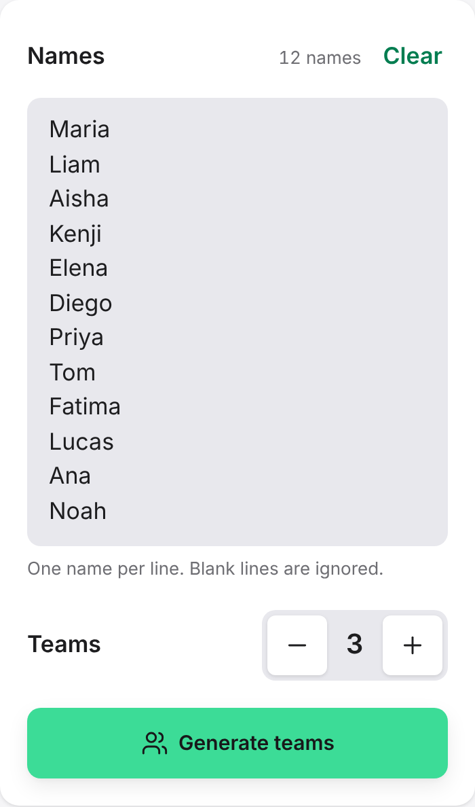
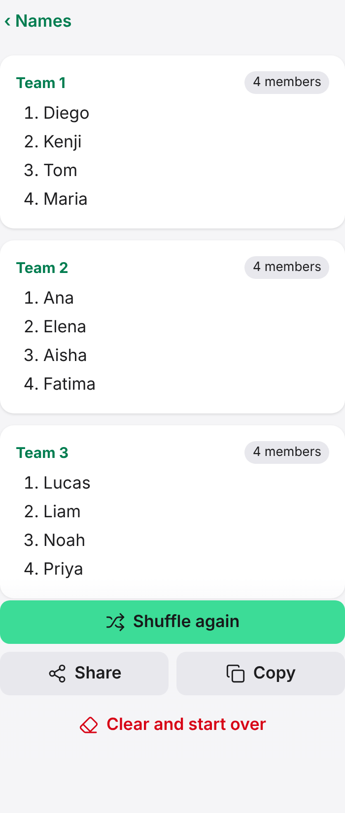

# Create teams

This guide shows you how to split a list of names into fair, random teams.

1. Open [TeamSync](https://simeontsvetanov.github.io/teamsync-random-team-generator/).
2. In **Names**, enter or paste the names, one per line. Blank lines are ignored, and the count of names appears next to the label.
3. Next to **Teams**, select **−** or **+** to choose how many teams you want, from 2 to 10.
4. Select **Generate teams**.

The following image shows a list of 12 names with 3 teams selected:

<picture>
  <source media="(prefers-color-scheme: dark)" srcset="../images/create-teams/form-dark.png">
  
</picture>

TeamSync shows each team with its members. Team sizes differ by at most one, and the bigger teams come first.

<picture>
  <source media="(prefers-color-scheme: dark)" srcset="../images/create-teams/result-dark.png">
  
</picture>

If you don't like the split, select **Shuffle again** for a different one. On a phone, select **‹ Names** to go back to the list.

## Tips

- To make the teams from the keyboard, press Ctrl+Enter (⌘+Enter on a Mac) in the **Names** box.
- If you paste a list from WhatsApp, Viber or a notes app, TeamSync removes numbers, bullets, emoji and `[time] Name:` prefixes and keeps only the names.
- On Android, after you [install TeamSync](install-app.md), you can select a message with a list in another app, select **Share** and choose TeamSync. The names are added to the **Names** box.
- If TeamSync shows a message in red, follow it. For example, you need at least two names and at least as many names as teams.

## Related

- [Share the teams](share-results.md)
- [Settings and limits](../reference/settings.md) — the limits on names and teams, and the `?teams=` link
- [TeamSync user documentation](../index.md)
